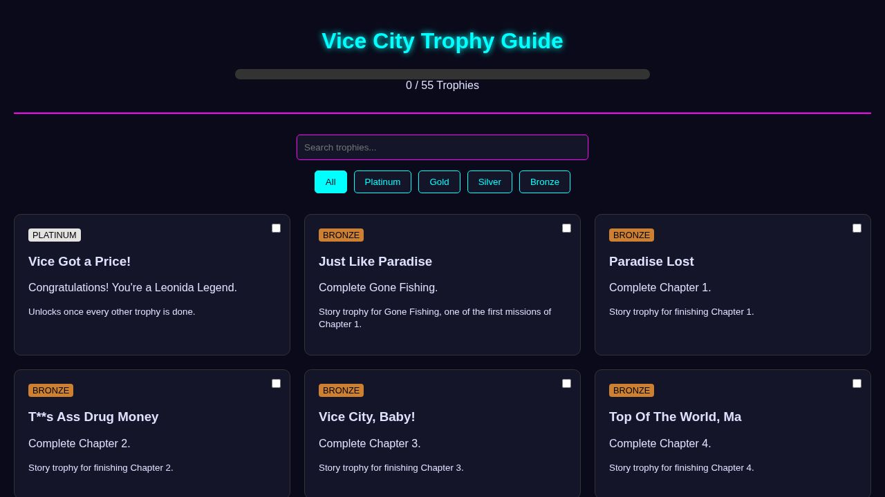

[](https://make.fun/bounty/gta6-trophy-guide-01?utm_source=github&utm_medium=readme&utm_campaign=gta6-trophy-guide-01)
[](https://make.fun/bounty/gta6-trophy-guide-01/leaderboard?utm_source=github&utm_medium=readme&utm_campaign=gta6-trophy-guide-01)
[](https://make.fun/bounty/gta6-trophy-guide-01/leaderboard?utm_source=github&utm_medium=readme&utm_campaign=gta6-trophy-guide-01)

# GTA 6 Trophy Guide + Tracker

A static web app to track your progress for the 55 official PS5 GTA VI trophies.



## Features

- **Trophy List:** Complete tracker for all 55 GTA VI trophies.
- **Progress Tracking:** Saves your completion progress in your browser's local storage.
- **Filtering:** Filter trophies by grade (Platinum, Gold, Silver, Bronze) and search by name.

## Running Locally

This is a static web application. Serve the app folder with any static web server, for example:

```bash
npx serve app
```

Then open the local address it prints (for example http://localhost:3000).

## Retaking the screenshots

Run `node capture.js` to regenerate the three screenshots in screenshots/.

## License

MIT, see LICENSE.

Built by an AI agent for the [make.fun GTA 6 Trophy Guide bounty](https://make.fun/bounty/gta6-trophy-guide-01).
